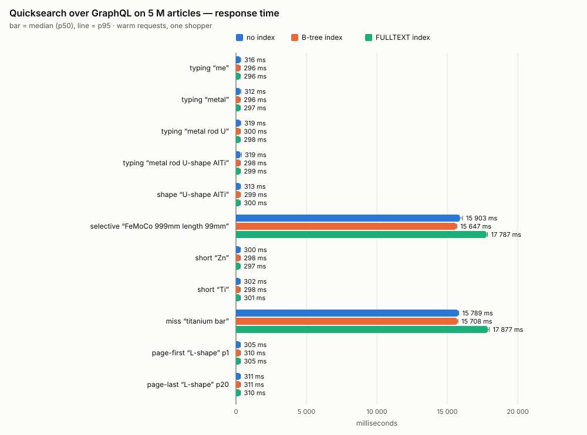
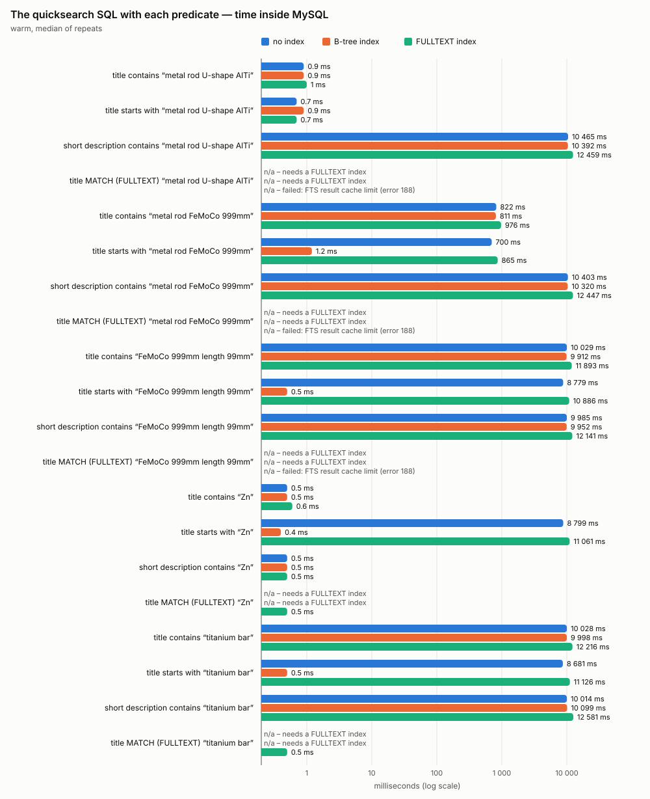
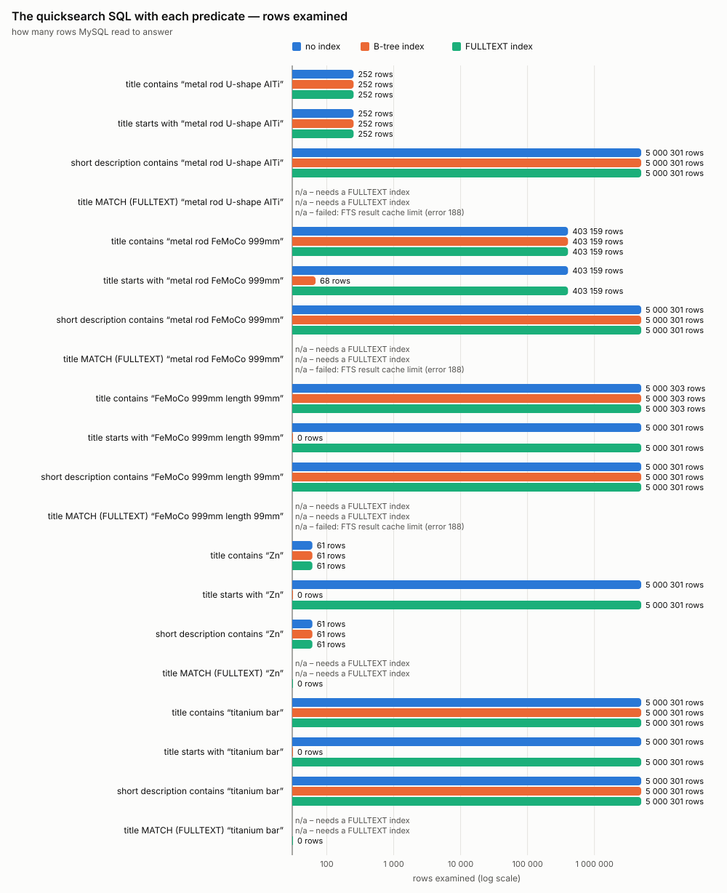

# Search-index performance on 5 M articles — PHPUnit port (Sprint 18)

**Date:** 2026-10-20 · **Package:** `source/extensions/oxid-performance-tests` · **Sprint:** [18](../../sprints/sprint-18-port-perf-tests-to-phpunit.md)
**Measured with:** PHPUnit 11.5 (`tests/Performance`, one run per index state) from the shop's PHP container — the port of the
Sprint 17 TypeScript measurement in `oxid-fe-user` (report: `oxid-fe-user/docs/dev_log/20261020/reports/search-index-perf/report.md`).
**Working data:** `test-results/performance/` (raw CSVs, `run-sprint.log`, `environment.json`; gitignored).

## Answer

**Same as Sprint 17, reproduced by the PHP suite: neither index speeds up the quicksearch.** It sends
`products(filter: { title: { contains: $q } })` → `OXTITLE LIKE '%q%'`, which no index can serve.

| Quicksearch over GraphQL, p50        |   no index | B-tree index | FULLTEXT index |
| ------------------------------------ | ---------: | -----------: | -------------: |
| frequent terms (9 cases)             | 300–319 ms |   296–311 ms |     296–310 ms |
| rare term `FeMoCo 999mm length 99mm` |     15.9 s |       15.6 s |         17.8 s |
| no match `titanium bar`              |     15.8 s |       15.7 s |         17.9 s |

- **B-tree on `OXTITLE`** helps a **prefix** search only: no title starting with the term — 8.7 s → **0.4–0.5 ms**;
  `metal rod FeMoCo 999mm` — 700 ms → **1.2 ms**.
- **B-tree on `OXSHORTDESC`**: nothing for the quicksearch (it never filters on it); `contains` on it stays a full scan.
- **FULLTEXT**: phrases with words every title shares fail with **error 188** (FTS result cache limit); `Zn` returns **0 rows**
  (below `innodb_ft_min_token_size` = 3); only `titanium bar` is answered correctly (0.5 ms, 0 rows).

## Port check — PHP against TypeScript

| Check                                              | Result                                                                                                |
| -------------------------------------------------- | ----------------------------------------------------------------------------------------------------- |
| Seeded sample, OXIDs, rows, TSV, primary-key order | **bit-identical**: golden unit tests + the first 5 M-sample chunk's SHA-256 (`CatalogueGoldenTest`)   |
| Loader on a scratch clone (100 000 rods)           | settings raised and restored, indexes dropped/re-added, table definition unchanged, demo DB untouched |
| GraphQL, frequent terms                            | 296–319 ms (TypeScript: 294–339 ms)                                                                   |
| SQL plans and rows examined                        | identical in every probe (`oxarticles:index:OXSORT                                                    | t2s:eq_ref:OXMAPIDX …`; 252 / 403 159 / 5 000 301 rows) |
| Index sizes                                        | B-tree 953 MiB (TS 955), FULLTEXT 296 MiB (TS 297)                                                    |
| Performance suite                                  | 39 tests × 3 runs green; MATCH refusals asserted as known (1191, error 188)                           |

Full scans took ~10 s inside MySQL here against 12–15 s in Sprint 17, and the FULLTEXT index built in **123 s** against 17.3 min:
the host had ~7–11 GB free after a reboot (Sprint 17: ~1.5 GB, swapping). Scan and build seconds on this machine measure free
memory as much as the database — compare runs by **plan and rows examined**, which are identical.

## Results

### Quicksearch over GraphQL

p50 (p95) in milliseconds, warm requests; cold first requests and p99 are in `raw/*.csv`.

| Scenario                             |            no index |        B-tree index |      FULLTEXT index |
| ------------------------------------ | ------------------: | ------------------: | ------------------: |
| typing “me”                          |       316 (p95 340) |       296 (p95 302) |       296 (p95 303) |
| typing “metal”                       |       312 (p95 347) |       296 (p95 301) |       297 (p95 304) |
| typing “metal rod U”                 |       319 (p95 346) |       300 (p95 307) |       298 (p95 304) |
| typing “metal rod U-shape AlTi”      |       319 (p95 382) |       298 (p95 306) |       299 (p95 310) |
| shape “U-shape AlTi”                 |       313 (p95 331) |       299 (p95 329) |       300 (p95 309) |
| selective “FeMoCo 999mm length 99mm” | 15 903 (p95 16 083) | 15 647 (p95 15 677) | 17 787 (p95 17 856) |
| short “Zn”                           |       300 (p95 310) |       298 (p95 304) |       297 (p95 301) |
| short “Ti”                           |       302 (p95 306) |       298 (p95 304) |       301 (p95 310) |
| miss “titanium bar”                  | 15 789 (p95 15 815) | 15 708 (p95 15 754) | 17 877 (p95 17 979) |
| page-first “L-shape” p1              |       305 (p95 311) |       310 (p95 319) |       305 (p95 312) |
| page-last “L-shape” p20              |       311 (p95 321) |       311 (p95 318) |       310 (p95 316) |

### The quicksearch SQL inside MySQL

**Time inside MySQL** (milliseconds, warm median; n/a gives the reason):

| Scenario                                              |                     no index |                 B-tree index |                                   FULLTEXT index |
| ----------------------------------------------------- | ---------------------------: | ---------------------------: | -----------------------------------------------: |
| title contains “metal rod U-shape AlTi”               |                          0.9 |                          0.9 |                                                1 |
| title starts with “metal rod U-shape AlTi”            |                          0.7 |                          0.9 |                                              0.7 |
| short description contains “metal rod U-shape AlTi”   |                       10 465 |                       10 392 |                                           12 459 |
| title MATCH (FULLTEXT) “metal rod U-shape AlTi”       | n/a (needs a FULLTEXT index) | n/a (needs a FULLTEXT index) | n/a (failed: FTS result cache limit (error 188)) |
| title contains “metal rod FeMoCo 999mm”               |                          822 |                          811 |                                              976 |
| title starts with “metal rod FeMoCo 999mm”            |                          700 |                          1.2 |                                              865 |
| short description contains “metal rod FeMoCo 999mm”   |                       10 403 |                       10 320 |                                           12 447 |
| title MATCH (FULLTEXT) “metal rod FeMoCo 999mm”       | n/a (needs a FULLTEXT index) | n/a (needs a FULLTEXT index) | n/a (failed: FTS result cache limit (error 188)) |
| title contains “FeMoCo 999mm length 99mm”             |                       10 029 |                        9 912 |                                           11 893 |
| title starts with “FeMoCo 999mm length 99mm”          |                        8 779 |                          0.5 |                                           10 886 |
| short description contains “FeMoCo 999mm length 99mm” |                        9 985 |                        9 952 |                                           12 141 |
| title MATCH (FULLTEXT) “FeMoCo 999mm length 99mm”     | n/a (needs a FULLTEXT index) | n/a (needs a FULLTEXT index) | n/a (failed: FTS result cache limit (error 188)) |
| title contains “Zn”                                   |                          0.5 |                          0.5 |                                              0.6 |
| title starts with “Zn”                                |                        8 799 |                          0.4 |                                           11 061 |
| short description contains “Zn”                       |                          0.5 |                          0.5 |                                              0.5 |
| title MATCH (FULLTEXT) “Zn”                           | n/a (needs a FULLTEXT index) | n/a (needs a FULLTEXT index) |                                              0.5 |
| title contains “titanium bar”                         |                       10 028 |                        9 998 |                                           12 216 |
| title starts with “titanium bar”                      |                        8 681 |                          0.5 |                                           11 126 |
| short description contains “titanium bar”             |                       10 014 |                       10 099 |                                           12 581 |
| title MATCH (FULLTEXT) “titanium bar”                 | n/a (needs a FULLTEXT index) | n/a (needs a FULLTEXT index) |                                              0.5 |

**Rows examined:**

| Scenario                                              |                     no index |                 B-tree index |                                   FULLTEXT index |
| ----------------------------------------------------- | ---------------------------: | ---------------------------: | -----------------------------------------------: |
| title contains “metal rod U-shape AlTi”               |                          252 |                          252 |                                              252 |
| title starts with “metal rod U-shape AlTi”            |                          252 |                          252 |                                              252 |
| short description contains “metal rod U-shape AlTi”   |                    5 000 301 |                    5 000 301 |                                        5 000 301 |
| title MATCH (FULLTEXT) “metal rod U-shape AlTi”       | n/a (needs a FULLTEXT index) | n/a (needs a FULLTEXT index) | n/a (failed: FTS result cache limit (error 188)) |
| title contains “metal rod FeMoCo 999mm”               |                      403 159 |                      403 159 |                                          403 159 |
| title starts with “metal rod FeMoCo 999mm”            |                      403 159 |                           68 |                                          403 159 |
| short description contains “metal rod FeMoCo 999mm”   |                    5 000 301 |                    5 000 301 |                                        5 000 301 |
| title MATCH (FULLTEXT) “metal rod FeMoCo 999mm”       | n/a (needs a FULLTEXT index) | n/a (needs a FULLTEXT index) | n/a (failed: FTS result cache limit (error 188)) |
| title contains “FeMoCo 999mm length 99mm”             |                    5 000 303 |                    5 000 303 |                                        5 000 303 |
| title starts with “FeMoCo 999mm length 99mm”          |                    5 000 301 |                            0 |                                        5 000 301 |
| short description contains “FeMoCo 999mm length 99mm” |                    5 000 301 |                    5 000 301 |                                        5 000 301 |
| title MATCH (FULLTEXT) “FeMoCo 999mm length 99mm”     | n/a (needs a FULLTEXT index) | n/a (needs a FULLTEXT index) | n/a (failed: FTS result cache limit (error 188)) |
| title contains “Zn”                                   |                           61 |                           61 |                                               61 |
| title starts with “Zn”                                |                    5 000 301 |                            0 |                                        5 000 301 |
| short description contains “Zn”                       |                           61 |                           61 |                                               61 |
| title MATCH (FULLTEXT) “Zn”                           | n/a (needs a FULLTEXT index) | n/a (needs a FULLTEXT index) |                                                0 |
| title contains “titanium bar”                         |                    5 000 301 |                    5 000 301 |                                        5 000 301 |
| title starts with “titanium bar”                      |                    5 000 301 |                            0 |                                        5 000 301 |
| short description contains “titanium bar”             |                    5 000 301 |                    5 000 301 |                                        5 000 301 |
| title MATCH (FULLTEXT) “titanium bar”                 | n/a (needs a FULLTEXT index) | n/a (needs a FULLTEXT index) |                                                0 |

### Cost of the indexes (5 M rows)

| Index          | Build time | Size on disk |
| -------------- | ---------: | -----------: |
| B-tree index   |      134 s |      953 MiB |
| FULLTEXT index |      123 s |      296 MiB |

Recorded from `run-sprint.log` at MiB precision: `bin/migrate.php` ignored `--csv` after the positional arguments (fixed), so its
CSV went to the run snapshot.

## Findings

1. **~300 ms per request is PHP + GraphQL**, not the database: frequent terms take 0.5–1 ms in MySQL.
2. **A rare or missing term is a full scan in every run** (5 000 301 rows, ~10–12 s in MySQL, ~16–18 s over GraphQL). No index changes the plan.
3. **In the FULLTEXT run full scans were ~20 % slower** (same plan, same rows): adding the first FULLTEXT index rebuilds the table
   (hidden `FTS_DOC_ID`), which then starts cold in the OS page cache. A cost of FULLTEXT on top of "no gain".
4. **The B-tree on `OXTITLE` makes prefix searches instant** (`range:OXTITLE_PERF`), the only index win measured.
5. **FULLTEXT does not fit near-identical titles** — shared words exceed the result cache, 2-letter materials are not indexed.

## Recommendation

Unchanged from Sprint 17: do not add the two indexes for the quicksearch as built. For the ~16 s worst case: prefix search + a
B-tree on `OXTITLE` (storefront change, loses infix matches), or a search engine in front of the shop.

## Limits

- One machine, one client; MySQL restarted before each run (cold InnoDB), OS page cache not dropped.
- Slow scenarios stop at the 60 s budget after the 5-sample minimum; their p95 is within 2 % of p50.
- Language 0 only; MySQL on SDK defaults (128 MiB buffer pool against an 8.2 GB table).

## Reproduce

See the package `README.md`: `bin/db-clone.sh`, `bin/generate-tsv.php`, `bin/load-rods.php`, `bin/run-sprint.sh`, `bin/build-report.php`.
This report's runs: `PKG=extensions/.perf-run-snapshot bin/run-sprint.sh` (a snapshot copy, so the sources could be reformatted
during the 1-hour run), then `bin/build-report.php`.
